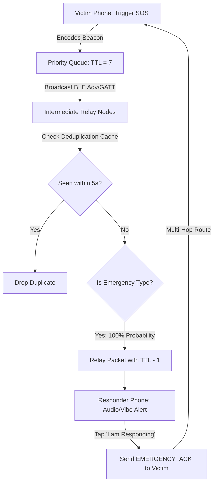

# Offline Disaster SOS & Emergency Mesh Triage System
## Final Year BE Project Documentation & Implementation Guide

---

## 1. Project Overview & Motivation

In acute disaster scenarios (such as earthquakes, flash floods, hurricanes, or landslides), conventional telecommunication infrastructure (cell towers, fiber backhauls, and electric grids) often fails within minutes. Standard emergency dispatch systems (911/112) and IP-based messaging applications (WhatsApp, Signal, Telegram) become completely inoperable.

### The Objective
To design and implement a **zero-infrastructure, multi-hop, decentralized emergency distress and triage protocol** integrated directly into the Bitchat Bluetooth Low Energy (BLE) mesh network. 

Any standard Android smartphone running Bitchat can:
1. **Broadcast distress telemetry** (triage severity level, exact GPS latitude/longitude, altitude/accuracy, battery percentage, timestamp, and optional victim note) across multiple hops without internet or SIM cards.
2. **Prioritize life-safety packets** at the routing layer so emergency beacons bypass normal chat duty-cycle sleep and congestion throttling.
3. **Provide immediate responder feedback** through bidirectional signed acknowledgments (`EMERGENCY_ACK`), reassuring trapped victims that search and rescue teams or nearby volunteers are en route.

---

## 2. Protocol Engineering & Binary Packet Layout

To ensure immediate delivery over resource-constrained Bluetooth LE channels without fragmentation, the distress telemetry is serialized into an ultra-compact binary payload using `java.nio.ByteBuffer` with Big-Endian byte ordering.

### A. New Message Types in `BinaryProtocol.kt`
Two new message types have been introduced:
- `EMERGENCY_BEACON (0x30u)`: Broadcast distress telemetry packet.
- `EMERGENCY_ACK (0x31u)`: Unicast responder acknowledgment packet.

### B. `EMERGENCY_BEACON` Payload Specification (Total Size: ~45–80 bytes)

```text
+---------------+---------------+--------------------+--------------------+--------------------+---------------+
| Flags (1B)    | Severity (1B) | Battery % (1B)     | Timestamp (8B)     | Beacon ID (1B+Var) | Nick (1B+Var) |
+---------------+---------------+--------------------+--------------------+--------------------+---------------+
| Note (2B+Var) | Latitude (8B) | Longitude (8B)     | Accuracy (4B)      |                                    |
+---------------+---------------+--------------------+--------------------+------------------------------------+
```

- **Bit Flags (1 Byte):**
  - Bit 0 (`0x01`): `hasLocation` (True if GPS fix is present).
  - Bit 1 (`0x02`): `isActive` (1 = Active distress; 0 = Resolved / "I am Safe").
  - Bit 2 (`0x04`): `hasAccuracy` (True if GPS horizontal accuracy radius is attached).
- **Severity Code (1 Byte):**
  - `0x01`: 🔴 **CRITICAL_MEDICAL** (Severe trauma, hemorrhage, cardiac, life threat).
  - `0x02`: 🟡 **TRAPPED_SEARCH_RESCUE** (Trapped under debris, in building collapse, floodwaters).
  - `0x03`: 🟠 **HAZARD_WARNING** (Active fire, gas leak, hazardous material, structural instability).
  - `0x04`: 🟢 **SUPPLIES_WATER** (Safe from physical harm but stranded; requires food, clean water, or insulin).
- **Battery Percentage (1 Byte):** Signed integer `[-1, 100]`. Vital for search teams to estimate remaining operational lifetime of the victim's device.
- **Timestamp (8 Bytes):** Epoch milliseconds (`Long`).
- **Variable Fields:**
  - `Beacon ID`: 1-byte length prefix + UTF-8 bytes (UUID).
  - `Sender Nickname`: 1-byte length prefix + UTF-8 bytes.
  - `Victim Note`: 2-byte length prefix + UTF-8 bytes (e.g. *"2 trapped, 3rd floor staircase"*).
- **Location Fields (Optional, 20 Bytes total):**
  - Latitude: 8-byte Double (IEEE 754).
  - Longitude: 8-byte Double (IEEE 754).
  - Accuracy: 4-byte Float (meters).

---

## 3. Network Architecture & Storm Prevention

In Mobile Ad-Hoc Networks (MANETs), simple flooding can trigger a **broadcast storm problem**, where excessive packet collisions deplete wireless channel capacity. The system incorporates three defensive mechanisms:



1. **Guaranteed 100% Relay Probability:** Standard chat messages in Bitchat are relayed with adaptive probabilities (40%–100%) depending on network density to conserve power. In `PacketRelayManager.kt`, emergency beacons and ACKs are exempted from probabilistic dropping:
   ```kotlin
   if (packet.type == MessageType.EMERGENCY_BEACON.value || 
       packet.type == MessageType.EMERGENCY_ACK.value) {
       Log.w(TAG, "🚨 Emergency packet detected, guaranteed relaying")
       return true
   }
   ```
2. **Deduplication Cache:** Every node tracks seen beacon IDs in a concurrent timestamped map. Rapid echoes within 5 seconds are silently dropped unless the beacon status changes (e.g. from active to cancelled).
3. **Adaptive Periodic Re-Broadcast:** To survive dynamic topology changes (peers moving or joining), active beacons are re-broadcast every 20 seconds using Kotlin coroutine timers until cancelled.

---

## 4. User Experience & Triage Interface

### A. Distress Triggering
- **One-Tap Access:** Warning beacon icon integrated directly into the main top bar in `ChatHeader.kt`.
- **IRC Command Support:** Users or emergency operators can type:
  - `/sos` (opens interactive triage dialog)
  - `/sos medical 2 injured with leg fractures` (instant medical beacon)
  - `/sos trapped 3rd floor elevator` (instant search & rescue beacon)
  - `/sos cancel` (broadcasts "I am Safe" cancellation)
- **Haptic Beacon Feedback:** Physical confirmation using the authentic **Morse Code pattern for SOS** (`... --- ...`):
  - `[0, 150, 100, 150, 100, 150, 200, 400, 100, 400, 100, 400, 200, 150, 100, 150, 100, 150]`.

### B. High-Contrast Emergency Alert Banner
Whenever an emergency beacon is received by any node in the mesh:
- A pulsing, high-contrast Material 3 emergency card renders at the top of the chat view.
- Displays:
  - Severity badge (🔴 Critical Medical, 🟡 Trapped, 🟠 Hazard, 🟢 Supplies)
  - Victim handle (`@Alice`)
  - Real-time geodesic distance computed via Android `Location.distanceBetween` (e.g., `~140 m away`)
  - Battery percentage (e.g., `⚡ 28% batt`)
  - Time elapsed since distress call
  - Custom note text
  - Real-time responder counter (e.g., `✓ 2 responders en route: Bob, Charlie`)
  - **"I am Responding" Action Button:** Tapping immediately creates and transmits a signed `EMERGENCY_ACK` back to the victim.

---

## 5. Live Demonstration Guide for Project Viva / Evaluation

To present this feature to your examination panel:

### Preparation:
1. Use two Android devices (or emulators/phones): **Phone A (Victim)** and **Phone B (Responder)**.
2. Put **both phones into Airplane Mode** (turn OFF Wi-Fi, Mobile Data, and Hotspot).
3. Turn **ON Bluetooth** on both devices.
4. Launch Bitchat on both devices. They will discover each other over Bluetooth Low Energy.

### Step-by-Step Live Demo Script:

| Step | Action on Phone A (Victim) | Action on Phone B (Responder) | Observation & Examiner Talking Point |
| :--- | :--- | :--- | :--- |
| **1** | Tap the **Red SOS Icon** in the top bar (or type `/sos`). | Idle on main chat screen. | Highlight that the dialog automatically captures battery % and GPS location without requiring cellular service. |
| **2** | Select **🔴 Critical Medical**, type note: *"Severe trauma, need medical kit"*, tap **Broadcast Distress SOS**. | — | Phone A vibrates with the **Morse code for SOS** (`... --- ...`). Telemetry is packaged into an ultra-compact ~60 byte binary packet. |
| **3** | Displays active distress banner: *"DISASTER SOS BROADCASTING - Waiting for responders..."* | **Instantly vibrates and displays Red Emergency Banner** with `@VictimNickname`, battery %, coordinates, and distance! | Demonstrates real-time, off-grid multi-hop BLE propagation without any centralized backend or cellular tower. |
| **4** | — | Responder taps **"I am Responding 🤝"**. | Phone B button transforms to green `✓ Responded`. Sends `EMERGENCY_ACK` unicast packet to Phone A. |
| **5** | Phone A vibrates with confirmation pattern! Banner updates: *"✓ 1 responder incoming: @ResponderNickname"*. | Banner shows *"1 responder en route"*. | Proves the **bidirectional closed-loop triage mechanism**, reducing panic during real-world rescue ops. |
| **6** | Phone A taps **"I am Safe"** (or types `/sos cancel`). | Banner automatically dismisses on Phone B! | Demonstrates graceful state teardown and resolution beaconing. |

---

## 6. Project Defense / Viva Questions & Answers

### Q1: Why did you use raw binary encoding instead of JSON or Protocol Buffers?
> **Answer:** In BLE mesh networking, the Maximum Transmission Unit (MTU) without packet fragmentation is typically 185 to 512 bytes. JSON is text-based and verbose, consuming 200–400 bytes for headers and keys alone. Our custom binary format packs all vital triage fields (severity, double-precision GPS, battery, timestamp, IDs) into under 65 bytes, fitting comfortably in a single BLE GATT write without incurring packet fragmentation or dropped packets.

### Q2: How does the system handle nodes that are indoors or underground where GPS is unavailable?
> **Answer:** In `EmergencyBeacon`, the GPS fields are nullable, governed by the `hasLocation (0x01)` bit in the flags header. If `SystemLocationProvider` cannot acquire a GPS fix within the timeout, the beacon transmits with `hasLocation = 0`, omitting the 20 bytes of coordinate payload. The UI gracefully displays *"Location: GPS Unavailable"* while still delivering the victim's nickname, battery status, triage severity, and manual text note.

### Q3: What prevents a malicious node from spamming fake SOS beacons?
> **Answer:** In Bitchat's architecture, all transmitted packets are cryptographically signed using Ed25519 digital signatures (`signPacketBeforeBroadcast`). Furthermore, our `EmergencyManager` implements rate-limiting deduplication caches to discard spam echoes. In Option 4 of our design roadmap, this is further reinforced by the Web-of-Trust public key fingerprinting.

---

## 7. Modified & Created Files Summary

| File | Purpose |
| :--- | :--- |
| `app/src/main/java/com/bitchat/android/protocol/BinaryProtocol.kt` | Added `EMERGENCY_BEACON (0x30u)` and `EMERGENCY_ACK (0x31u)` packet types. |
| `app/src/main/java/com/bitchat/android/features/emergency/EmergencyModel.kt` | Data classes `EmergencySeverity`, `EmergencyBeacon`, `EmergencyAck` with `ByteBuffer` binary encoders/decoders. |
| `app/src/main/java/com/bitchat/android/features/emergency/EmergencyManager.kt` | Central emergency coordinator: state management, battery/GPS query, Morse vibration, periodic rebroadcast. |
| `app/src/main/java/com/bitchat/android/mesh/PacketProcessor.kt` | Added routing pathways for `EMERGENCY_BEACON` and `EMERGENCY_ACK`. |
| `app/src/main/java/com/bitchat/android/mesh/PacketRelayManager.kt` | Configured 100% priority relaying for emergency packets. |
| `app/src/main/java/com/bitchat/android/mesh/MessageHandler.kt` | Added beacon and ack deserialization and delegate forwarding. |
| `app/src/main/java/com/bitchat/android/mesh/BluetoothMeshService.kt` | Public broadcast/ACK transmission methods and delegate wiring. |
| `app/src/main/java/com/bitchat/android/ui/MeshDelegateHandler.kt` | Connected mesh callbacks to `EmergencyManager` and system notifications. |
| `app/src/main/java/com/bitchat/android/ui/NotificationManager.kt` | Dedicated `EMERGENCY_CHANNEL_ID` with heads-up alarm priority. |
| `app/src/main/java/com/bitchat/android/ui/ChatViewModel.kt` | ViewModel bridge exposing `broadcastSos()`, `cancelSos()`, `respondToSos()`. |
| `app/src/main/java/com/bitchat/android/ui/emergency/EmergencySOSDialog.kt` | Material 3 triage selection dialog with battery/GPS status chips. |
| `app/src/main/java/com/bitchat/android/ui/emergency/EmergencyAlertBanner.kt` | Real-time alert card showing distance, battery, severity, and "Respond" button. |
| `app/src/main/java/com/bitchat/android/ui/ChatHeader.kt` | Integrated emergency warning icon in the main app bar. |
| `app/src/main/java/com/bitchat/android/ui/ChatScreen.kt` | Embedded alert banner and modal SOS dialog. |
| `app/src/main/java/com/bitchat/android/ui/CommandProcessor.kt` | `/sos` IRC command parser (`/sos [severity] [note]`, `/sos cancel`). |
| `app/src/test/java/com/bitchat/android/features/emergency/EmergencyBeaconTest.kt` | Comprehensive JUnit test suite validating binary round-trips and protocol integration. |

